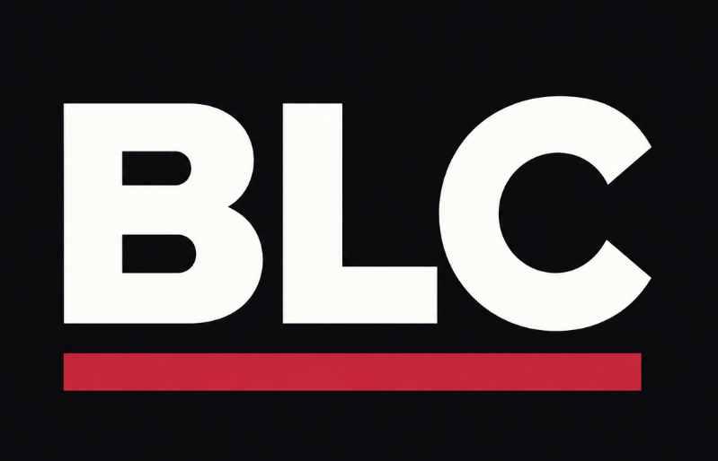

# BLCA RUSH

**By BLCA Development Team · MIT · Arma Reforger**



طور RUSH مستقل ومفتوح المصدر: أربعة سكترات، هدفا A/B في كل سكتر، تفعيل وتفكيك البومب، انتقال القتال، رسبون السكواد، حدود القتال وHUD تكتيكي. يعمل مع **اللعبة الأساسية فقط**، ويأتي معه سيناريو Arland بفريقي US وUSSR ومعدات اللعبة الأصلية.

Standalone, open-source RUSH: four sectors, two A/B objectives per sector, arming/defusing, sector progression, squad deployment, combat boundaries, and a tactical HUD. Requires **only the base game**, with an included Arland scenario using vanilla US/USSR factions and equipment.

- [الدليل العربي](Documentation/README_AR.md)
- [English guide](Documentation/README_EN.md)
- [إعداد الخريطة / Map integration](Documentation/MAP_INTEGRATION.md)
- [Contributing / المساهمة](CONTRIBUTING.md)
- [License](LICENSE)

```text
Project: BLCA_RUSH
GUID: B1CA525553480001
Scenario: {94AA9386CDB35E4F}Missions/BLCA_Rush_Arland.conf
Dependency: 58D0FB3206B6F859 (Arma Reforger base game)
```

The add-on is source-ready for Workbench and publication. A project GUID alone does not establish Workshop publication; use the ID returned by the actual publication when configuring a downloaded Workshop item.
